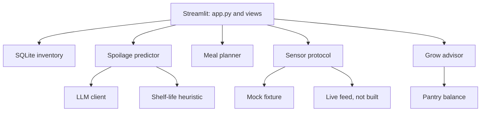

# Architecture

Fallow is a small pipeline. The Streamlit screens in `views/` collect an
inventory and a sensor reading, then call plain Python functions. Those
functions do not import Streamlit, which is why the tests can run them with
no browser. `fallow_ui.py` is only the shared look.

## Models

`larder/models.py` is the shared language of the app.

- `InventoryItem` is one food in the kitchen.
- `SpoilageRisk` is how soon that food goes bad, and whether a model or the table said so.
- `MealPlan` is a few meals. Each meal carries the inventory ids it uses.
- `GrowPlan` is a planting list plus the pantry gaps that list is meant to cover.

Pydantic checks these shapes when JSON comes in from a fixture, the database,
or the model.

## Spoilage

`predict_spoilage` is the only function the pages call.

1. If there is no client, or the call raises, it uses `heuristic_risks`.
2. An item with `expires_on` uses that date. Days left can be negative.
3. An item with no expiry uses `shelf_life.py`: named foods first, then the
   category, then 14 days.
4. Bands: 0 or fewer days is critical, 1–2 is high, 3–5 is medium, and the
   rest is low.
5. A model row whose id is not in the inventory is dropped. Items the model
   skips are filled from the table. The stored name always stays the
   inventory name.

The client in `larder/llm/client.py` posts to an OpenAI-compatible
`/chat/completions` endpoint. It retries timeouts and bad JSON. It does not
retry HTTP 400, 401, or 403. The reply must validate as `SpoilageReport`.

## Meals

`plan_meals` never adds a food you did not pass in. A risk for an unknown id
is ignored. Meals are created only for medium, high, and critical items, soonest
first, capped by `horizon_days`. The calmest grain, pantry item, or loaf is
added beside the perishable when one exists. Cooking does not yet subtract
from the inventory. The plan is a list, not a write-off.

## Sensors

`Sensor` in `larder/sensors/base.py` is a protocol: any object with
`read() -> SensorSnapshot` qualifies. A protocol is a structural contract.
The mock and the live class are not required to inherit from a base class.

- `MockSensor` reads `fixtures/sensor.sample.json`.
- `LiveSensor.read` raises `LiveSensorUnavailable`. The class is the slot
  the real feed will fill. It must not invent weather.

`SENSOR_MODE` selects which one `current_sensor()` returns.

## Garden

`advise` is a rule list keyed off the snapshot:

- Frost, cold temperature, or a winter month: kale, spinach, garlic.
- Warm months without frost: bush beans, potatoes, chard.
- The shoulder in between: kale, peas, radishes.
- Dry soil drops thirsty spinach and adds thyme.

The season comes from the snapshot timestamp, so the sample fixture tells the
same story whenever you open it.

`balance.py` looks three days out. A group is a gap when nothing in it lasts
longer than that. The groups are fresh food, calorie staples, and protein.
Canned or dry beans count as protein even though their category is pantry.
`explain_balance` says which of those gaps the planting list covers.

## Store

`data/fallow.db` holds one row per item. The row is the item's JSON, so the
table does not drift from `InventoryItem`. `open_store` loads the sample
fixture only when the database file is created.

## What this baseline leaves open

- The live sensor feed.
- Asking the model to write meals or planting advice. Those two stay
  deterministic so they work offline and stay easy to test.
- Asking the model to write the recipe steps. The steps are templates. Marking
  a meal cooked on Food & recipes reduces the pantry amounts.

Bugs and rough edges that are intentionally left for a later pass are listed
in [known-issues.md](known-issues.md).
